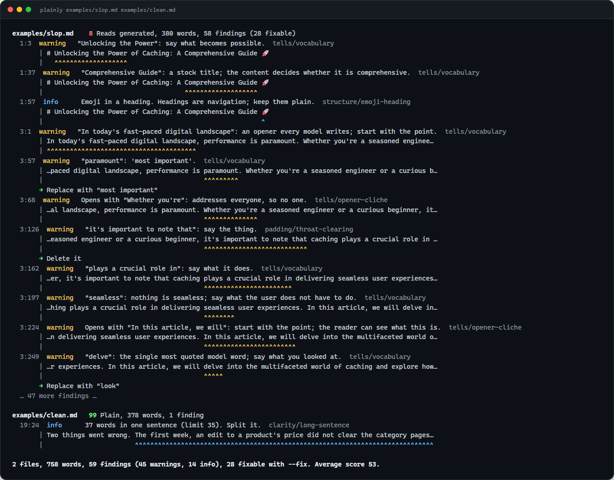
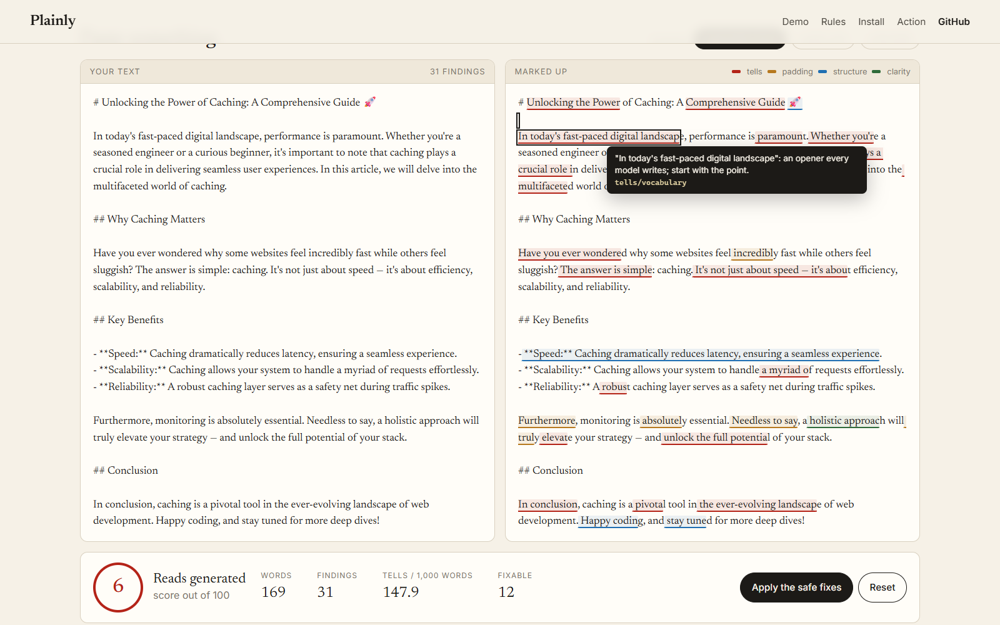

# Plainly

**A linter for prose that reads like a bot wrote it.**

Plainly reads Markdown and plain text and marks the sentences a reader would skip. It knows the stock words language models overuse, the throat-clearing before the point, the "not just X, but Y" frame, the bold-label bullet list, the "In conclusion" and the "Happy coding!". It scores each file from 0 to 100, fixes what can be fixed safely, and runs as a GitHub Action that annotates the pull request.



Zero dependencies. Python 3.11 or newer. MIT. [Try it in the browser](#the-site) on your own text.

## Why

Generated text has habits. None of them is wrong on its own: people write "robust" and use em dashes and end with a summary. The tell is the density. A page with "delve", "tapestry", "testament", three triads and five em dashes per thousand words was not written by someone choosing words, and readers can feel it even when they cannot name it.

Plainly names it. Each finding says what the pattern is, why it reads as generated, and what to write instead. The score is for the file; the findings are for the sentence.

## Install

```bash
pip install git+https://github.com/owaiskhalid-si/plainly
plainly README.md docs/
```

Or run it without installing: `pipx run --spec git+https://github.com/owaiskhalid-si/plainly plainly README.md`.

## Use

```bash
plainly                      # every .md, .mdx and .txt under the current folder
plainly docs/ README.md      # these
plainly --fix docs/          # apply the safe fixes in place
plainly --diff docs/         # show the fixes as a patch without writing
plainly --changed origin/main   # only files changed on this branch
git log -1 --format=%B | plainly --stdin --stdin-name commit   # a commit message
plainly rules                # every rule, with on/off and fixable
plainly explain tells/em-dash
```

Exit code 1 when a file scores under `--fail-under` or has a finding at or above `--fail-on` (default: `error`, which no rule emits unless you promote one in config). Exit 2 for a usage or config error.

**Output formats** (`--format`): `pretty` for terminals, `github` for workflow annotations, `json`, `sarif` (GitHub code scanning, with fixes attached), `markdown` (a score table for job summaries and PR comments).

**Markdown-aware.** Code blocks, inline code, URLs, link targets, HTML, front matter and tables are not prose and are never flagged; every finding and fix lands on the exact characters in the source. Switch rules off inline with `<!-- plainly-disable -->` … `<!-- plainly-enable -->`, `<!-- plainly-disable-next-line tells/vocabulary -->` or `<!-- plainly-disable-file -->`.

## Rules

Twenty-five rules in four categories. Twenty-two are on by default; `passive`, `readability` and `question-heading` are opinions you opt into. `plainly rules` lists them; `plainly explain RULE` shows examples.

| Category | Rules |
|---|---|
| **tells**: patterns that mark text as generated | `vocabulary` (delve, tapestry, testament, realm, seamless, robust, crucial, leverage…), `opener-cliche`, `summary-closer`, `setup-fragment` ("Here's the thing", "The best part?"), `not-just-but`, `rhetorical-question`, `em-dash` (density), `triad` (density) |
| **padding**: words that take up room | `throat-clearing` ("It is important to note that"), `wordy` ("in order to"), `vague-quantity` ("numerous"), `intensifier` ("very"), `double-hedge` ("may potentially") |
| **structure**: the shape of the text | `bold-lead-bullets`, `same-opener`, `sentence-rhythm`, `emoji-heading`, `sign-off`, `question-heading` (off) |
| **clarity**: plain English | `jargon`, `long-sentence`, `nominalisation`, `double-word`, `passive` (off), `readability` (off) |

Fixes are applied only where they cannot change the meaning. A run-up is deleted and the next word re-capitalised. A word is swapped for its plain equivalent, keeping its ending ("empowers" → "helps") and its article ("a" becomes "an" before a vowel). A doubled word loses its twin. Everything else is a message.

### The score

Each finding costs points by severity and by how strong a tell it is. The cost per hundred words goes through a curve tuned so that one tell per hundred words lands in the 80s, three in the 50s, and a page where every sentence has one lands under 20. The verdicts are **Plain** (85+), **A few tells**, **Padded**, **Reads generated** (under 40). The report also prints tells per thousand words, which is the number to watch in a document you did not write.

## Configure

`plainly init` writes a `plainly.toml`; a `[tool.plainly]` table in `pyproject.toml` works too.

```toml
include = ["**/*.md", "docs/**/*.txt"]
exclude = ["CHANGELOG.md", "vendor"]
fail-under = 60
fail-on = "error"
allow = ["robust", "seamless"]        # words your project uses on purpose
enable = ["clarity/passive"]
disable = ["structure/emoji-heading"]

[rules."clarity/long-sentence"]
max-words = 40
severity = "warning"
```

**Adopting it on an old project:** `plainly --write-baseline` records today's findings in `.plainly-baseline.json`; later runs report only new ones. Entries are keyed by file, rule and matched text, so they survive line shifts.

## GitHub Action

```yaml
name: Prose
on: [pull_request]
permissions:
  contents: read
  security-events: write   # only if sarif: true
jobs:
  plainly:
    runs-on: ubuntu-latest
    steps:
      - uses: actions/checkout@v4
        with: { fetch-depth: 0 }
      - uses: owaiskhalid-si/plainly@main
        with:
          changed-since: origin/${{ github.base_ref }}
          fail-under: "60"
          sarif: "true"
```

The action annotates the changed lines in the diff, writes a score table to the job summary, and (with `sarif: true`) sends the findings to the Security tab with one-click fixes. Inputs: `paths`, `changed-since`, `fail-under`, `fail-on`, `args`, `sarif`, `summary`, `python-version`. Outputs: `score`, `findings`.

**pre-commit:**

```yaml
- repo: https://github.com/owaiskhalid-si/plainly
  rev: main
  hooks:
    - id: plainly          # or plainly-fix
```

## The site



`site/` is a static page with a live demo that calls `api/lint.py`, a Python function that runs the same engine. Locally: `python site/dev.py` and open http://localhost:3900. On Vercel the folder deploys as-is (`vercel.json` serves `site/` and bundles `src/` with the function). `python scripts/export_rules.py` regenerates the rule catalogue the site shows; CI fails if it is stale.

## How it's checked

| Check | What | Run |
|---|---|---|
| Unit tests | The Markdown view (masking, offsets, directives, CRLF), every rule's examples fire and their rewrites don't, fixes are idempotent and never overlap, scoring, config, baseline, the CLI's exit codes and every output format, `--fix`, `--diff`, `--stdin`, `--changed` against a real git repo | `pytest` (89 tests) |
| Types and lint | mypy strict, ruff | `mypy`, `ruff check .` |
| The action on itself | CI runs `uses: ./` on this README and must score 85 or better | [ci.yml](.github/workflows/ci.yml) |
| Matrix | Python 3.11–3.14 on Ubuntu, 3.12 on Windows; the built wheel is installed and run | [ci.yml](.github/workflows/ci.yml) |

## Development

```bash
python -m venv .venv && . .venv/bin/activate     # .venv\Scripts\activate on Windows
pip install -e ".[dev]"
pytest && ruff check . && mypy
```

Rules live in `src/plainly/rules/`; word lists in `src/plainly/lexicon.py`. A rule is a function registered with `@rule(...)` that takes a `Document` and returns findings with source offsets. Every rule needs a `why` and at least one example, and the test suite checks that the example trips the rule and its rewrite does not.

## Licence

[MIT](LICENSE)
